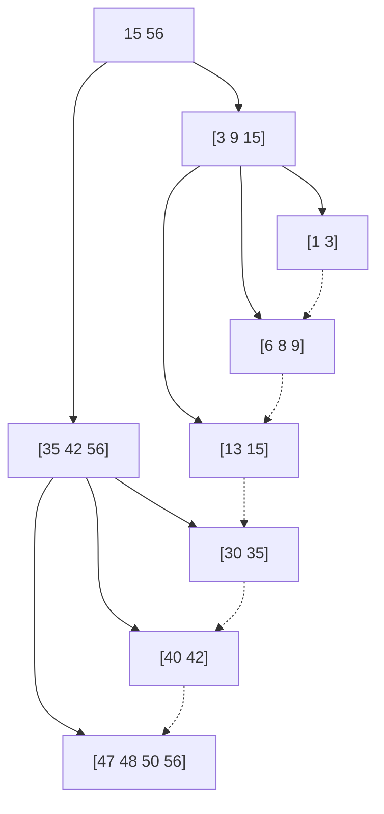

## B+树

> [!warning] 注意
> B+树是B树的一种变型，从形状上看和B树很像，可以类比记忆。B+树原理和分块查找也很类似。

- **定义**：一棵m阶的B+树需满足下列条件：
1. 每个**分支结点**最多有m棵子树（孩子结点）。
2. 非叶根结点**至少有两棵子树**，其他每个分支结点**至少有$\lceil m/2\rceil$棵子树**。
3. 结点的**子树个数与关键字个数相等**。
4. 所有**叶结点**包含全部关键字及指向相应记录的指针，叶结点中将关键字按大小顺序排列，并且相邻叶结点按大小顺序相互链接起来。
5. 所有**分支结点**（可视为**索引的索引**）中仅包含它的各个子结点（即下一级的索引块）中关键字的最大值及指向其子结点的指针。

## 相关
- [[B树]]
- [[分块查找]]
