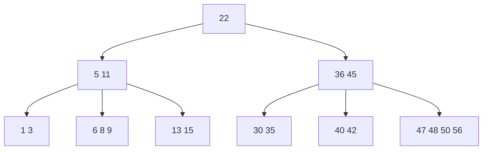
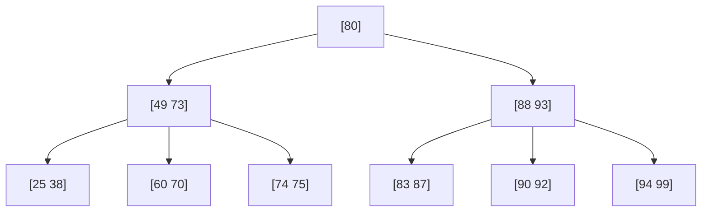

## B树

> [!question] 思考
> 二叉排序在任何一个结点上都将数值分为两个部分，如根结点就能将整数范围分为(-∞,根)和(根,+∞)。本质上是一个二叉树，为提高效率，引入**多路查找树**，即n叉查找树，**每个结点中含有多个关键字**，这样整个树高就低，效率更高。

- **B树**，又称**多路平衡查找树**，B树中所有结点的孩子个数的最大值称为B树的阶，通常用m表示。

> [!question] 思考
> 多于刚才讲到的多路查找树，如果不对每个结点内的关键字个数做限制，若每个结点内关键字太少，如都只包含一个关键字，就会退化成二叉查找树，导致树变高，要查更多层结点，效率低。

→一棵m阶B树或为空树，或为满足如下**特性**的m叉树：
1. 树中每个结点**至多**有 m 棵子树，即**至多含有m-1个关键字**。
2. 若根结点不是叶结点，则**至少有两棵子树**。并规定对于任何一个结点，其**所有子树的高度都要相同**。
3. 除根结点外的所有非叶结点至少有$\lceil m/2\rceil$棵子树，即**至少含有$\lceil m/2\rceil$-1个关键字**。
4. 所有的叶结点都出现在**同一层次**上，并且**不带信息**（可以视为外部结点或类似于折半查找判定树的查找失败结点，实际上这些结点不存在，指向这些结点的指针为空）。
5. 任一结点关键字的值**有序**，且**子树0<关键字1<子树1<关键字2....**，类似二叉排序树的**左<中<右**。

- **B树的高度**：在含有n个关键字的m阶B树，其高度和查找效率息息相关，能够推导高度很重要。
1. **最小高度**：每个结点中尽可能多的关键字。 （尽量的**胖**）
2. **最大高度**：相同结点数下，每个结点中尽可能少的关键字。

> [!note] 推导
> **高度公式**（讲义这两条只给了方向，公式是我据定义推的，非讲义原文；$n$ 为关键字总数、$h$ 为层数）：
> 1. **最小高度** $\lceil\log_m(n+1)\rceil$：让每个结点都**尽量胖**，则h层最多有 $1+m+m^2+\cdots+m^{h-1}=\frac{m^h-1}{m-1}$ 个结点，即最多 $m^h-1$ 个关键字，故 $n\le m^h-1$，即 $h\ge\log_m(n+1)$。
> 2. **最大高度** $\lceil\log_{\lceil m/2\rceil}((n+1)/2)\rceil+1$：让每个结点都**尽量瘦**，则第1层1个结点、第2层2个、此后每层至少 $\lceil m/2\rceil$ 倍，故h层关键字总数最少为 $2\lceil m/2\rceil^{h-1}-1$，即 $n\ge 2\lceil m/2\rceil^{h-1}-1$，得 $h\le\log_{\lceil m/2\rceil}((n+1)/2)+1$。

- **B树的插入**：【在插入一个关键字后】
   1. 若导致原结点关键字数**超过上限**，则从**中间位置$\lceil m/2\rceil$**将其中的关键字分为两部分，**左部分包含的关键字放在原结点中，右部分包含的关键字放在新结点中**，中间位置$\lceil m/2\rceil$的结点插入原结点的父结点。
   2. 若导致其父结点的关键字个数也**超过了上限**，则继续进行**分裂**操作，直至这个过程传到根结点为止，进而导致B树高度增1。

> [!warning] 注意
> 在m阶B树，除根结点外，结点关键字个数$\lceil m/2\rceil$-1≤n≤m-1。

→例、 从空树依次插入关键字25,38,49,60,80,90,99,88,83,87,70,92,93,94,73,74,75构造**5阶**B树。

> [!note] 推导
> **上例的构造过程**（按「从中间位置$\lceil m/2\rceil$分」即第$\lceil m/2\rceil$个关键字上移的口径推演，非讲义原文；下列每步都是**插入并完成必要分裂后的整棵树**）：
> 1. 插入25、38、49、60：根结点为`[25 38 49 60]`。
> 2. 插入80：`[25 38 49 60 80]`超过上限4，从中间位置（第3个）49分两部分——`[25 38]`留原结点、`[60 80]`进新结点、49插入父结点（成为新根）：`[49]` / `[25 38]` `[60 80]`。
> 3. 插入90、99：[49] / [25 38] [60 80 90 99]。
> 4. 插入88：[60 80 90 99 88]超上限，从中间位置（第3个）88分——`[60 80]`、`[90 99]`，88上移到父结点：[49 88] / [25 38] [60 80] [90 99]。
> 5. 插入83：[49 88] / [25 38] [60 80 83] [90 99]。
> 6. 插入87：[49 88] / [25 38] [60 80 83 87] [90 99]。
> 7. 插入70：`[60 80 83 87]`中插入70得`[60 70 80 83 87]`超上限，从第3个80分——`[60 70]`、`[83 87]`，80上移到父结点：[49 80 88] / [25 38] [60 70] [83 87] [90 99]。
> 8. 插入92：[49 80 88] / [25 38] [60 70] [83 87] [90 92 99]。
> 9. 插入93：[49 80 88] / [25 38] [60 70] [83 87] [90 92 93 99]。
> 10. 插入94：`[90 92 93 99]`中插入94得`[90 92 93 94 99]`超上限，从第3个93分——`[90 92]`、`[94 99]`，93上移到父结点：[49 80 88 93] / [25 38] [60 70] [83 87] [90 92] [94 99]。
> 11. 插入73：[49 80 88 93] / [25 38] [60 70 73] [83 87] [90 92] [94 99]。
> 12. 插入74：[49 80 88 93] / [25 38] [60 70 73 74] [83 87] [90 92] [94 99]。
> 13. 插入75：`[60 70 73 74]`中插入75得`[60 70 73 74 75]`超上限，从第3个73分——`[60 70]`、`[74 75]`；73上移到父结点`[49 80 88 93]`得`[49 73 80 88 93]`**也超上限**，于是**继续分裂根**：从第3个80分——`[49 73]`、`[88 93]`，80上移成为**新根**，**B树高度增1**。
> 14. 最终得到3层B树：

> [!note] 校验
> - 共17个关键字；除根外各结点关键字个数都在 $\lceil m/2\rceil$-1=2 ~ m-1=4 之间；所有叶结点都在第3层。
> - 树高 h=3，落在下面「B树的高度」两条公式给出的区间内：最小高度 $\lceil\log_m(n+1)\rceil=\lceil\log_5 18\rceil=2$，最大高度 $\lceil\log_{\lceil m/2\rceil}((n+1)/2)\rceil+1=\lceil\log_3 9\rceil+1=4$，即 $2\le h\le 4$。

- **B树的删除**：
1. 若被删除关键字在**终端结点**，则直接删除该关键字，**需要保证关键字个数是否低于下限$\lceil m/2\rceil$-1**。
2. 若被删除关键字在**非终端结点**，则用直接前驱或直接后继来替代被删除的关键字。
3. 若删除结点导致关键字个数**低于下限**，则：
   - 若**兄弟够借**，即与此结点右或左兄弟结点的关键字还比较多，则需要调整该结点、右或左兄弟结点及其双亲结点。用当前结点的前驱或后继来填补空缺。
   - 若**兄弟不够借**，即与该结点相邻的左右结点的关键字个数均=「m/2」-1，则将关键字删除后与左或右兄弟结点及双亲结点中的关键字进行合并。在合并过程中，双亲结点的关键字个数减少到下限，则同需要和其兄弟结点进行调整或合并操作。

> [!warning] 注意
> 直接前驱：当前关键字左侧指针所指子树中最右下的元素；直接后继：当前关键字右侧指针所指子树中最左下的元素。

> [!warning] 注意
> 删除非终端结点的过程实质是转换为终端结点的删除。

## 相关
- [[红黑树]]
- [[B+树]]
- [[查找的基本概念]]
