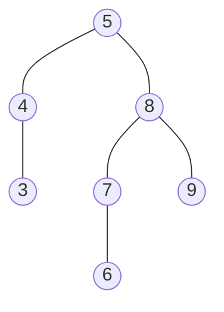

## 二叉排序树

> [!question] 思考
> 通过前面折半判定树就能体会到，对于**有序的序列**，可以通过**二叉树**的形式来描述。

→所以有些数据可以通过某二叉树的存储方式来实现查找的应用。

- **二叉排序树**：又称**二叉查找树**(BST，Binary Search Tree)，可以是一棵空树，或者符合：
1. 若左子树非空，则**左子树**上所有结点的值均**小于**根结点的值；
2. 若右子树非空，则**右子树**上所有结点的值均**大于**根结点的值；
3. 左、右子树**也分别是**一棵二叉排序树。
→也是**递归**的定义。 并且主要性质(**左子树结点值 < 根结点值 < 右子树结点值**)。
→观察得二叉树**中序遍历得递增有序序列**。

- 二叉排序树的查找：
若树非空，目标值和**根结点**的值进行比较，若相等则查找成功；若**小于**根结点则在**左子树**上查找；若**大于**则在**右子树**上查找。查找成功则返回结点指针；查找失败返回NULL。
对于递归结构，都可以用**递归方式**实现某个操作。



```c
typedef struct BSTNode{
	int key;
	struct BSTNode *lchild, *rchild;
}BSTNode, *BSTree;

BSTNode *BST_Search(BSTree T, int key){
	while(T!=NULL&&key!=T->key){ //若树空或等于根结点值，则结束循环
		if(key < T->key)
			T=T->lchild; //小于，则在左子树上查找
		else
			T=T->rchild; //大于，则在右子树上查找
	}
	return T;
}
```

```c
BSTNode *BST_Search(BSTree T, int key){
	if(T==NULL) return NULL; //查找失败
	if(key==T->key) return T; //查找成功
	else if(key>T->key) return BST_Search(T->rchild, key);//在右子树找
	else return BST_Search(T->lchild, key);//在左子树找
}
```

- 二叉排序树的插入：
若原二叉排序树为空，则直接插入结点；否则，若关键字k小于根结点值，则插入到左子树，若关键字k大于根结点值，则插入到右子树。

```c
int BST_Insert(BSTree &T, KeyType k){
	if(T==NULL){   //原树为空，新插入的记录为根结点
		T=(BSTree)malloc(sizeof(BSTNode));
		T->key=k;
		T->lchild=T->rchild=NULL;
		return 1;  //返回1，插入成功
	}
	else if(k==T->key)  //树中存在相同关键字的结点，插入失败
		return 0;
	else if(k<T->key)  //插入到T的左子树
		return BST_Insert(T->lchild, k);
	else //插入到T的右子树
		return BST_Insert(T->rchild, k);
}
```

- 二叉排序树的删除
→在树中删除如果碰到分支节点就很难办，如何在删了后重新**保持BST的性质不变**很重要。
1. 若被删除结点z是**叶结点**，则直接删除，不会破坏二叉排序树的性质；
2. 若结点z**只有一棵左子树或右子树**，则让z的子树成为z父结点的子树，替代z的位置。
3. 若结点z**有左、右两棵子树**，则令z的直接后继（或直接前驱）替代z，然后从二叉排序树中删去这个直接后继（或直接前驱），这样就转换成了第一或第二种情况。

- [[平衡二叉树]]

## 相关
- [[折半查找]]
- [[查找的基本概念]]
