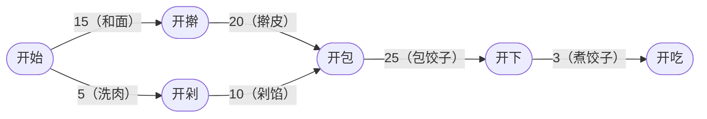

## 关键路径

> [!question] 思考
> 在一个有向带权图中，顶点和边都可以表示实际含义，权值也能表示实际含义。

- **关键路径**：从源点到汇点的所有路径中，具有**最大路径长度**的路径称为关键路径。
- **关键活动**：关键路径上的活动。也可以理解为这些活动的变化可能会影响到整个工程的进度。
- **工程最短时间**：完成整个工程的**最短时间**就是**关键路径的长度**，若关键活动不能按时完成，则整个工程的完成时间就会延长。
→为了最快完成工程，关键路径上的活动基本**容不得一点懈怠**，但是非关键活动可以**忙里偷点闲**。
→找到关键活动，就找到了关键路径，就可以得出最短完成时间。

- **AOE网**：在带权有向图中，**以顶点表示事件，以有向边表示活动，以边上的权值表示完成该活动的开销**（如完成活动所需的时间），称之为**用边表示活动**的网络，简称AOE网。
- **源点**：仅有一个入度为0的顶点称为开始顶点，表示整个工程的开始。
- **汇点**：网中也仅存在一个出度为0的顶点称为结束顶点，表示整个工程的结束。
- 只有在某顶点所代表的事件发生后，从该顶点出发的有向边代表的活动才能开始。
- 只有在进入某顶点的**各有向边**所代表的活动**都已结束**时，该顶点所代表的事件才能发生。
- 有些活动是可以**并行进行**的，有些活动则只能串行进行。

- **事件$v_k$的最早发生时间$ve(k)$**：决定了所有从$v_k$开始的活动能够开工的最早时间。
- **活动$a_i$的最早开始时间$e(i)$**：指该活动弧的起点所表示的事件的最早发生时间。
→只要确定事件的最早发生时间，就能得到以此点做弧尾的活动的最早开始时间。
- **事件$v_k$的最迟发生时间$vl(k)$**：在**不推迟整个工程**完成的前提下，该事件最迟必须发生的时间。
- **活动$a_i$的最迟开始时间$l(i)$**：指该活动弧的终点所表示事件的**最迟发生时间**与该活动所需时间之差。
- **时间余量**：一个活动$a_i$的$l(i)$和$e(i)$的差额$d(i)$，在不增加完成整个工程所需总时间的情况下，活动$a_i$可以拖延的时间。若一个活动的时间余量为零，则说明该活动**必须**要如期完成，否则就会拖延整个工程的进度。即$d(i)$为0或$l(i)=e(i)$的活动是**关键活动**。而由关键活动组成的路径就是**关键路径**。

### 算法过程

1. 从源点出发，令$ve(源点)=0$，按拓扑有序求其余顶点的最早发生时间$ve()$；
→$ve(k)=Max\{ve(j)+Weight(v_j, v_k)\}$，$v_j$为$v_k$的任意前驱。
2. 从汇点出发，令$vl(汇点)=ve(汇点)$，按逆拓扑有序求其余顶点的最迟发生时间$vl()$。
→$vl(k)=Min\{vl(j)-Weight(v_k, v_j)\}$，$v_j$为$v_k$的任意后继。
3. 根据各顶点的 $ve()$值求所有弧的最早开始时间 $e()$。即找到边尾事件的最早开始时间。
4. 根据各顶点的 $vl()$值求所有弧的最迟开始时间 $l()$。即找到边头时间的最晚发生时间-活动时间。
5. 求所有活动的时间余量$d()$， $d(i)=l(i)-e(i)$。

### 特性总结

> [!warning] 总结
> 1. 关键路径上的所有活动都是关键活动，它是决定整个工程的关键因素。若关键活动耗时**增加**，则整个工程的时间则增长。
> 2. 可通过加快关键活动来缩短整个工程的工期。但也不能任意缩短关键活动，因为一旦缩短到一定的程度，**该关键活动就可能会变成非关键活动**。
> 3. **网中的关键路径并不唯一**，且对于有几条关键路径的网，只提高一条关键路径上的关键活动速度并不能缩短整个工程的工期，只有**加快那些包括在所有关键路径上的关键活动**才能达到缩短工期的目的。

## 相关
- [[图]]
