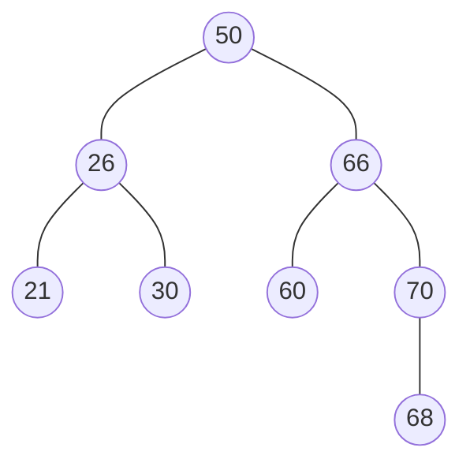

## 平衡二叉树

> [!question] 思考
> 在一个二叉排序树中查找某个数据，查找次数会跟数据所在**树层次**有关，处于层次越深则查找次数越多。所以二叉排序树的**平均查找长度和树高是有关**的。**树越高平均长度越大**。

→对于n个结点的二叉树，**一定是尽量让树高降低**，查找效率才高。

- **平衡二叉树**(Balanced Binary Tree, AVL树)：树上任一结点的左子树和右子树的**高度之差不超过1**，且左子树和右子树**都是**平衡二叉树。
- **平衡因子**：结点**左子树高-右子树高**为该结点的平衡因子，则平衡二叉树结点的平衡因子的值只可能是-1、0或1。

- 平衡二叉树的插入：

> [!note] 算法思想
> 首先检查其插入路径上的结点是否因为此次操作而**导致了不平衡**。若导致了不平衡，则先找到插入路径上离插入结点**最近**的平衡因子的**绝对值大于1**的结点A，再对以A为根的子树，调整各结点的位置关系，使之重新达到平衡。

- **最小不平衡子树**：每次调整的对象就是。

> [!question] 思考
> 如何调整最小不平衡子树重新平衡呢？分为几种情况就能概括。

→最小不平衡子树根结点为A，则无非插入A的左孩子左子树or右子树、或右孩子左or右子树。
1. **LL平衡旋转（右单旋转）**：在A的**左孩子的左子树**中插入导致不平衡。

> [!note] 方法
> 将A的左孩子B向右上旋转代替A成为根结点，将 A结点向右下旋转成为B的右子树的根结点，而B的原右子树则作为A结点的左子树。

2. **RR平衡旋转（左单旋转）**：在A的**右孩子的右子树**中插入导致不平衡；

> [!note] 方法
> 将A的右孩子B向**左上旋转**代替A成为根结点，将A结点向**左下旋转**成为B的左子树的根结点，而B的原左子树则作为A结点的右子树。

3. **LR平衡旋转（先左后右双旋转）**：在A的**左孩子的右子树**中插入导致不平衡；

> [!note] 方法
> 先将A结点的左孩子B的右子树的根结点C向**左上旋转**提升到B结点的位置，然后把该C结点向**右上旋转**提升到A结点的位置。

4. **RL平衡旋转（先右后左双旋转）**：在A的**右孩子的左子树**中插入导致不平衡。

> [!note] 方法
> 先将A结点的右孩子B的左子树的根结点C向**右上旋转**提升到B结点的位置，然后把该C结点向**左上旋转**提升到 A结点的位置。

- **平衡二叉树的查找**：
查找过程和**二叉排序树**相同，若**树高为h**，则**最坏情况**下，查找一个关键字最多需要对比h次，即查找操作的时间复杂度不可能超过O(h)。

> [!note] 记忆
> 含有n个结点的平衡二叉树的最大深度为O（$\log_2n$），因此平衡二叉树的平均查找长度为O（$\log_2n$）。

- 假设以$n_h$表示深度为h的平衡树中含有的最少结点数。
→显然， 有$n_0=0$， $n_1=1$， $n_2=2$， 并且有$n_h=n_{h-1}+n_{h-2}+1$。
→知道这些就能快速确定树高， 如9个结点， 则树高最多为4。

- **平衡二叉树的删除**：
删除结点后，要保持二叉排序树的特性不变(左<中<右)，若删除结点导致不平衡，则需要进行调整使之符合平衡二叉树特性。
删除和插入的调整方式相似。首先根据删除后的情况对平衡因子进行分析，找到最小不平衡子树，对其进行左右旋调整。

> [!note] 实现步骤
> 1. 用二叉排序树的方法对结点执行删除操作。
> 2. 从被删结点w开始，向上回溯，找到第一个不平衡的**结点z**（即最小不平衡子树）；**y**为结点z的高度最高的孩子结点；**x**是结点y的高度最高的孩子结点。当然找不到就说明没有失衡。
> 3. 然后对以z为根的子树进行平衡调整，其中**x**、 **y**和**z**可能的位置有4种情况： LL/RR/LR/RL
> 4. 对最小不平衡子树的调整可能导致树变矮，从而**导致上层祖先不平衡**，需要继续进行调整。

- [[红黑树]]

## 相关
- [[二叉排序树]]
- [[查找的基本概念]]
