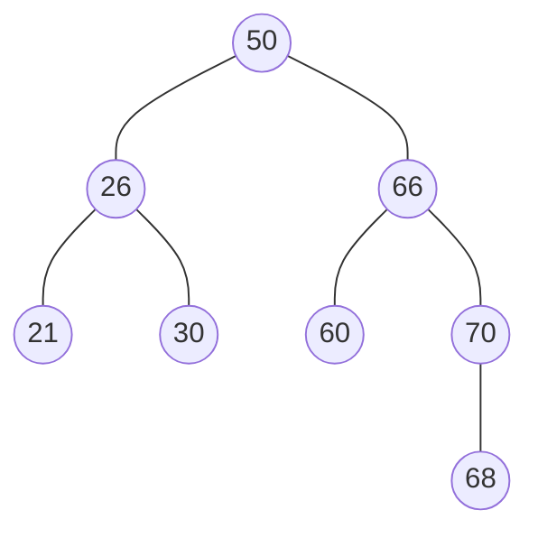

## 平衡二叉树

> [!question] 思考
> 在一个二叉排序树中查找某个数据，查找次数会跟数据所在**树层次**有关，处于层次越深则查找次数越多。所以二叉排序树的**平均查找长度和树高是有关**的。**树越高平均长度越大**。

→对于n个结点的二叉树，**一定是尽量让树高降低**，查找效率才高。

- **平衡二叉树**(Balanced Binary Tree, AVL树)：树上任一结点的左子树和右子树的**高度之差不超过1**，且左子树和右子树**都是**平衡二叉树。
- **平衡因子**：结点**左子树高-右子树高**为该结点的平衡因子，则平衡二叉树结点的平衡因子的值只可能是-1、0或1。

- 平衡二叉树的插入：

> [!note] 算法思想
> 首先检查其插入路径上的结点是否因为此次操作而**导致了不平衡**。若导致了不平衡，则先找到插入路径上离插入结点**最近**的平衡因子的**绝对值大于1**的结点A，再对以A为根的子树，调整各结点的位置关系，使之重新达到平衡。

- **最小不平衡子树**：每次调整的对象就是。

> [!question] 思考
> 如何调整最小不平衡子树重新平衡呢？分为几种情况就能概括。

→最小不平衡子树根结点为A，则无非插入A的左孩子左子树or右子树、或右孩子左or右子树。
1. **LL平衡旋转（右单旋转）**：在A的**左孩子的左子树**中插入导致不平衡。

> [!note] 方法
> 将A的左孩子B向右上旋转代替A成为根结点，将 A结点向右下旋转成为B的右子树的根结点，而B的原右子树则作为A结点的左子树。

2. **RR平衡旋转（左单旋转）**：在A的**右孩子的右子树**中插入导致不平衡；

> [!note] 方法
> 将A的右孩子B向**左上旋转**代替A成为根结点，将A结点向**左下旋转**成为B的左子树的根结点，而B的原左子树则作为A结点的右子树。

3. **LR平衡旋转（先左后右双旋转）**：在A的**左孩子的右子树**中插入导致不平衡；

> [!note] 方法
> 先将A结点的左孩子B的右子树的根结点C向**左上旋转**提升到B结点的位置，然后把该C结点向**右上旋转**提升到A结点的位置。

## 相关
- [[二叉排序树]]
- [[查找的基本概念]]
