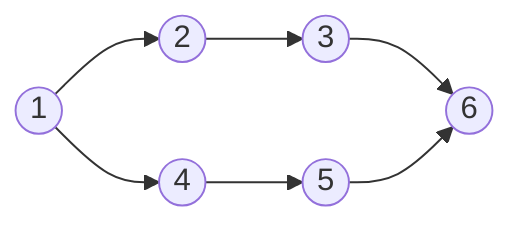

## 拓扑排序

> [!question] 思考
> 有向无环图长得还有点像流程图，是否可用来描述某事件的流程图。

- **AOV网**：用 **DAG图(有向无环图)** 表示一个工程，其**顶点表示活动**，用有向边 $<V_i,V_j>$ 表示活动 $V_i$ **必须先于**活动 $V_j$ 进行的这样一种关系，则将这种有向图称为**顶点表示活动的网络**，记为AOV网。
→在AOV 网中，活动 $V_i$ 是活动 $V_j$ 的**直接前驱**，活动 $V_j$ 是活动 $V_i$ 的**直接后继**，这种前驱和后继关系具有**传递性**，且任何活动 $V_i$ 不能以它**自己**作为自己的前驱或后继。
→按照一定的顺序排列各活动产生一个**序列**，使之符合前驱后继关系，这个过程称为**拓扑排序**。
→每个AOV网都有**一个或多个拓扑排序序列**。

> [!question] 思考
> 如何在一个AOV网中获取正确的活动执行序列。

### 拓扑排序

- **拓扑排序**：由一个有向无环图的顶点组成的序列，当且仅当满足下列条件时，称为该图的一个拓扑排序：
1. 每个顶点出现且**只出现一次**；
2. 若顶点A在序列中排在顶点B的前面，则在图中不存在从顶点B到顶点A的路径。

### 拓扑排序实现

- **拓扑排序实现**：1.从AOV网中选择一个没有前驱的顶点并输出；2.从网中删除该顶点和所有以它为起点的有向边；3.重复1.和2.直到当前的AOV网为空或当前网中不存在无前驱的顶点为止。
- 逆拓扑排序实现：相反。

> [!tip] 总结
> 1. 若一个顶点有多个直接后继，则拓扑排序的结果通常不唯一；但若各个顶点已排在一个线性有序的序列中，每个顶点有唯一的前驱后继关系，则拓扑排序的结果是唯一的。
> 2. 由于AOV网中各顶点的地位平等，每个顶点编号是**人为的**，因此可以按拓扑排序的结果重新编号，生成AOV网的新的邻接存储矩阵，这种邻接矩阵可以是**三角矩阵**；但对于一般的图来说，若其邻接矩阵是三角矩阵，则存在拓扑序列；反之则不一定成立。

【思考】有向有环图是否有拓扑排序。

## 相关
- [[图]]
- [[有向无环图描述表达式]]
