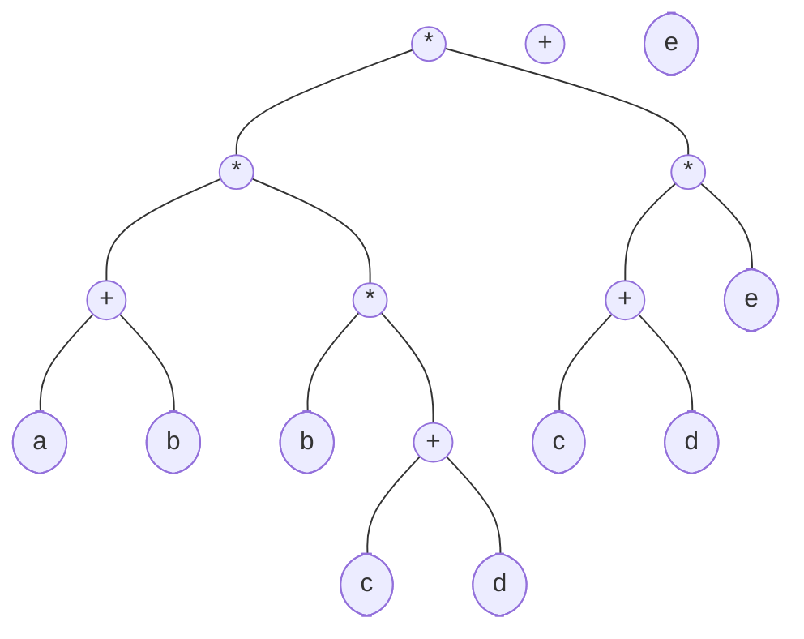
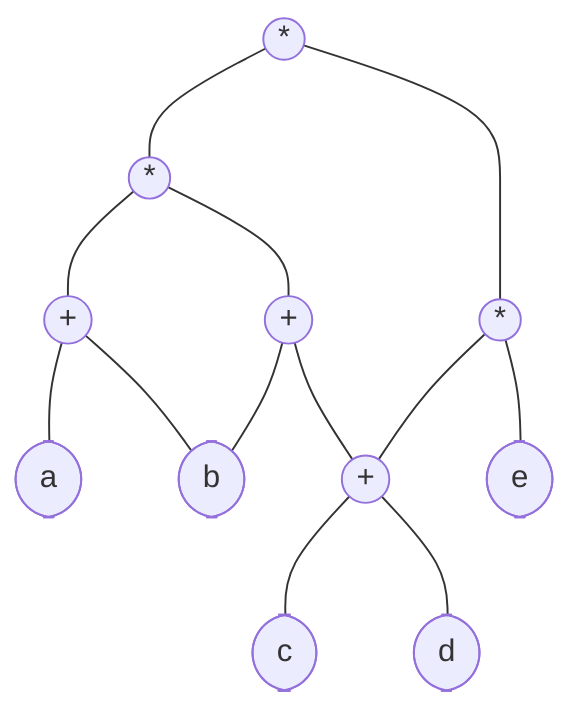

## 有向无环图描述表达式

> [!note] 前提
> 二叉树可以表示一个计算式，如a+b可以表示为以+为根，左为a右为b。

- **有向无环图**：若一个有向图中不存在环，则称为有向无环图，简称**DAG图**。
→有向无环图是**描述含有公共子式的表达式**的有效工具。
如表达式((a+b)*(b*(c+d))+(c+d)*e)*((c+d)*e)如果用二叉树描述如下。

→可发现有一些相同的子表达式在二叉树中重复出现，有向无环图可**实现对相同子式的共享**，节省存储空间。

把相同的子表达式共用同一个结点，即得有向无环图：

## 相关
- [[图]]
