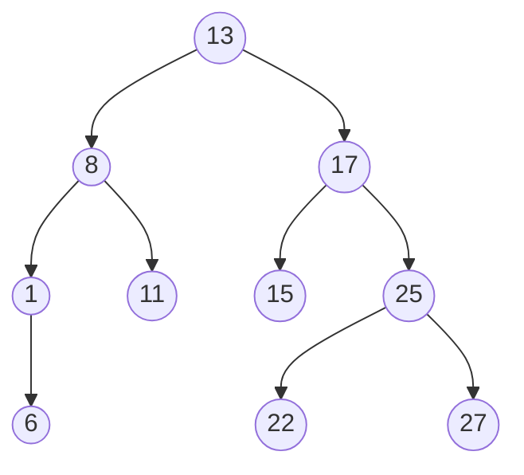
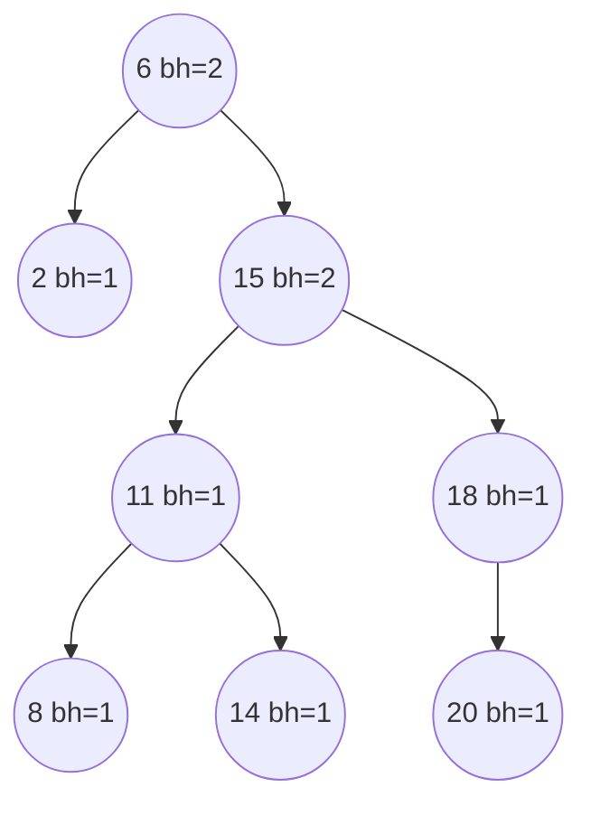

## 红黑树

> [!question] 思考
> 对平衡二叉树的插入删除操作**很容易破坏其平衡特性**，需要**频繁调整**树的形态，**代价大**，引入红黑树。

→引入红黑树后，插入和删除在很多时候并不会破坏红黑树的特性，**无需频繁调整**树的形态。

> [!warning] 注意
> 平衡二叉树适用于**以查为主**，很少插入或删除的场景；红黑树适用**频繁插入或删除**的场景。

> [!note] 定义
> 一棵红黑树是满足如下红黑性质的二叉排序树：
> 1. 每个结点或是红色，或是黑色的。
> 2. 根结点是黑色的。
> 3. 叶结点（虚构的外部结点、NULL 结点、失败结点）都是黑色的。
> 4. 不存在两个相邻的红结点（即红结点的父结点和孩子结点均是黑色的）。
> 5. 对每个结点，从该结点到任一叶结点的简单路径上，所含黑结点的数量相同。

> [!tip] 总结
> 概括红黑树特性就是： ①左<根<右； ②根和叶必黑； ③无邻红； ④路径上黑相同。

- **黑高**（记为bh）：从某结点出发（不含该结点）到达一个叶结点的任一简单路径上的黑结点总数。

- 性质：
1. 从根结点到叶结点的最长路径不大于最短路径的2倍；
2. 有n个内部结点的红黑树的高度 $h≤2\log_2(n+1)$。
→红黑树的查找操作时间复杂度为O($\log_2n$)。

- **红黑树的查找**：与BST、AVL相同，从根出发，若目标小于根则去其左子树查找，若目标大于根则去其右子树查找，若查找到一个空叶结点，则查找失败。
- **红黑树的插入**：和平衡二叉树的插入过程基本类似，不同之处在于，红黑树中插入新结点后需要进行调整（主要通过**重新着色**或**旋转**操作进行），以满足红黑树的性质。
- **红黑树的删除**：只需记住时间复杂度为O(log₂n)；处理方式和二叉排序树相同，只不过如果删除导致不符合红黑树特质则调整。

## 相关
- [[平衡二叉树]]
- [[查找的基本概念]]
